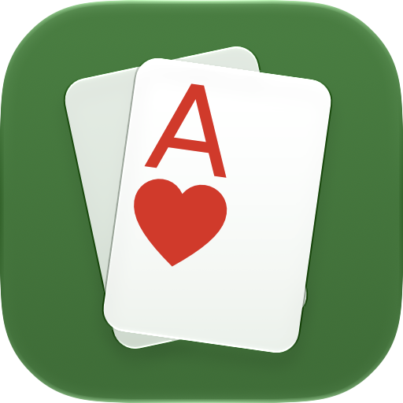
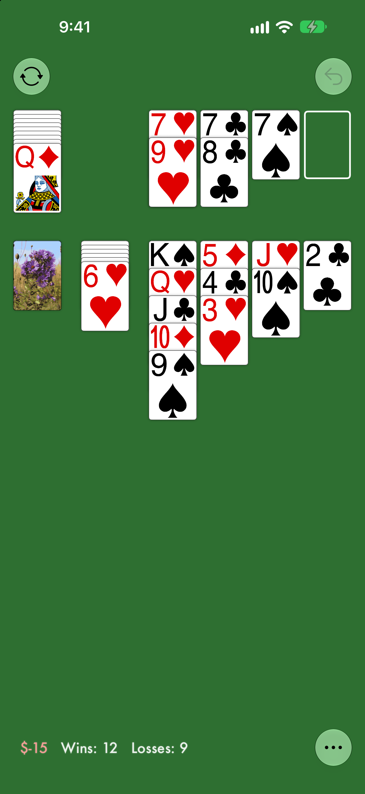
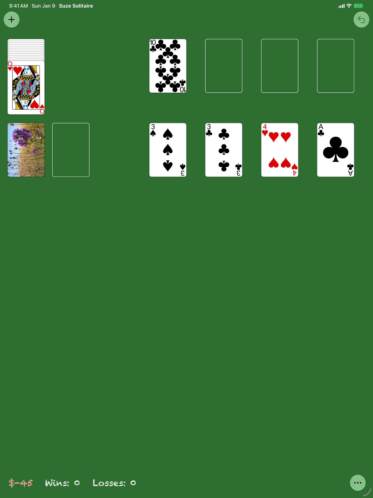
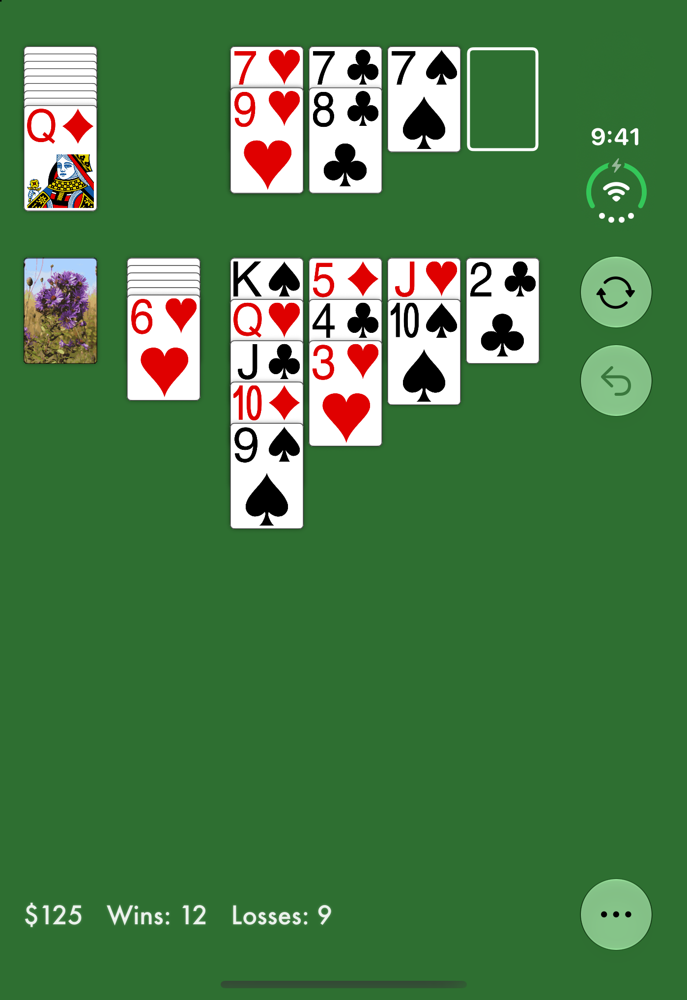
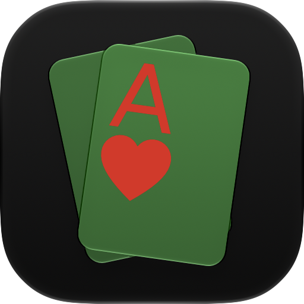
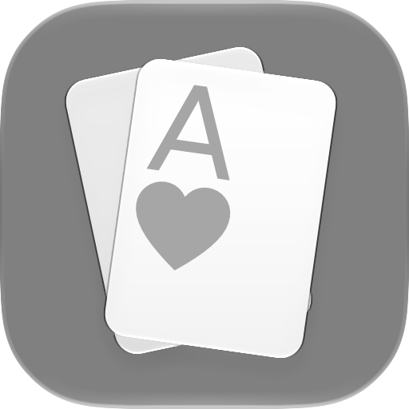
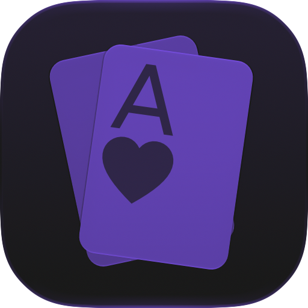
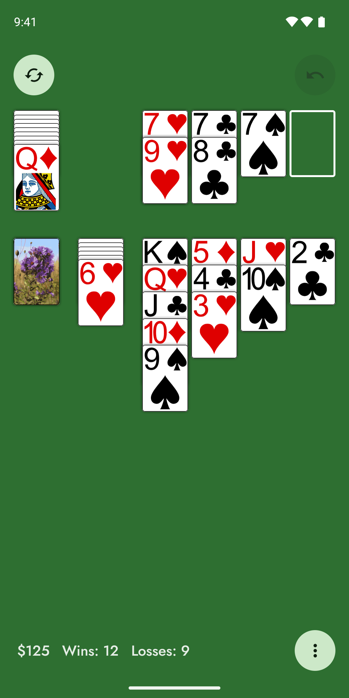
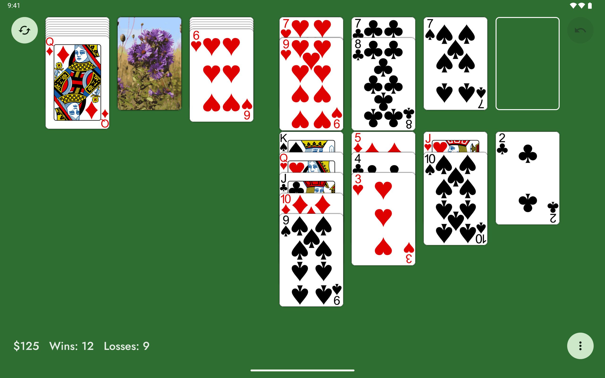
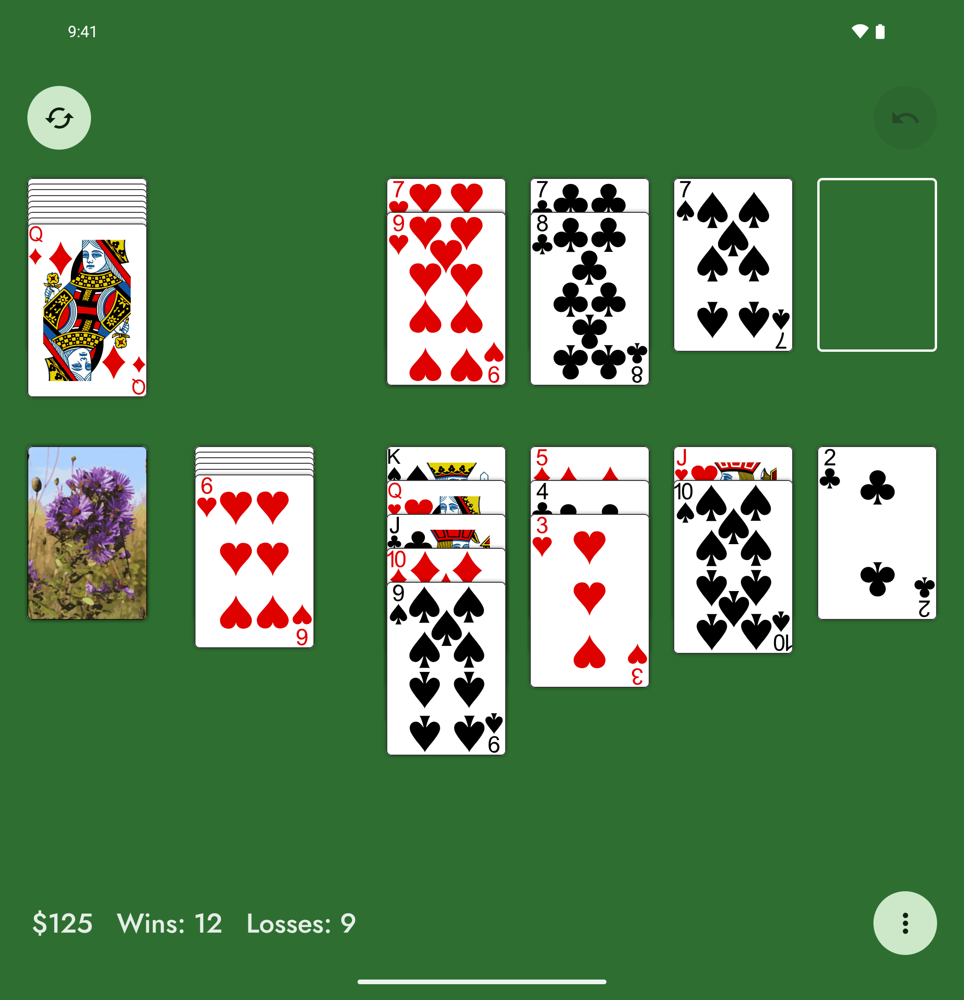

# Suze Solitaire

A classic Canfield-style solitaire for iPhone, iPad, iPhone Duo and Android, written by Kevin DeRonne in 2016, brought
up to date with Xcode 27 and iOS 27 in 2026, and brought to Android.

Thirteen cards start face up in the blind beside the deck. One card is dealt to the upper stacks, and its rank starts
all four of them. Build the upper stacks up by suit, wrapping from King to Ace, and build the four lower stacks down in
alternating colors. Deal from the deck three cards at a time, as often as you like. Each card you put up earns $5, a
win earns $250, and every new game costs $45 (Vegas-style scoring). The full rules are under **How to Play** in the
app's "…" menu.

## Screenshots

| iPhone | iPad | iPhone Duo (folded) |
| :---: | :---: | :---: |
|  |  |  |

These are the App Store screenshots, made by `scripts/screenshots.sh` from the game in progress in
`AppStore/Screenshots/game-in-progress.json`.

## Features

- **Play your way:** drag cards and runs, double-tap a card to send it up, or tap anywhere on the table to deal.
- **Undo:** takes back the last move or deal, or New Game if it was tapped by mistake.
- **Unlimited Undo** (a $5 in-app purchase): steps back a turn at a time, auto moves included, to the start of the
  game. It's bought or restored from the "…" menu.
- **Help when you want it:** Hint, Auto Moves, Highlight Drop Spot and Show When Stuck, all in the "…" menu and off
  until you turn them on.
- **Every layout:** portrait and landscape on iPhone and iPad, Split View, Slide Over and Stage Manager, and iPhone Duo
  folded or unfolded. New Game is always top left, Undo top right and "…" bottom right, with the score along the bottom.
- **Accessibility:** full VoiceOver support, with actions to select and move cards, and a score that follows the text
  size set in Settings.
- **Personal touches:** dark mode with a dimmer table, any photo as the card back, and gentle haptics.
- **Saved automatically:** the game, score, wins and losses survive quitting the app.

No ads, no accounts, and no data collected; see the [privacy policy](AppStore/PRIVACY.md).

## Icon

The icon is an Icon Composer document, `Suze Solitaire/AppIcon.icon`: a white card with a red A and heart, fanned over
a second card on green felt. iOS draws it in each appearance:

| Default | Dark | Clear | Tinted |
| :---: | :---: | :---: | :---: |
|  |  |  |  |

The images in `AppStore/Icon` are exported from it with Icon Composer's `ictool`.

## Building

You need Xcode 27 (27.1 for the iPhone Duo simulator). The app runs on iOS 17 and later and is written in Swift 6.

1. Open `Suze Solitaire.xcodeproj` and run the **Suze Solitaire** scheme.
2. To sign with your own team, create a git-ignored `Signing.local.xcconfig` next to `Signing.xcconfig` that sets
   `DEVELOPMENT_TEAM` and `PRODUCT_BUNDLE_IDENTIFIER`. `Signing.xcconfig` holds the defaults and the version number.

Run the tests (91 of them, covering the rules, layout in every orientation, saving, undo, the in-app purchase and the
card faces) with:

```sh
scripts/test.sh                                   # on an iPhone 18 Pro simulator, about 20 seconds
scripts/test.sh "iPad Pro 13-inch (M5)" -only-testing:"Suze SolitaireTests/Suze_SolitaireTests/testWindowSizeChoosesLayout"
```

It fails any test that runs over a minute instead of hanging, and skips the diagnostics xcodebuild otherwise collects
from the simulator after a run, which can take it ten minutes. The purchase test uses a StoreKit test session, so it
needs no Apple Account; the app doesn't check the real App Store while it hosts the tests.

## Scripts

| Script | What it does |
| --- | --- |
| `scripts/testflight.sh` | Archives the app and uploads it to TestFlight with an App Store Connect API key, then sends it to the external test group. Its settings go in a git-ignored `scripts/testflight.local.env`. |
| `scripts/screenshots.sh` | Regenerates the App Store screenshots: 6.9" iPhone, 13" iPad in landscape, and iPhone Duo folded. |
| `scripts/layout-screenshots.sh` | Screenshots every layout (iPhone and iPad in both orientations, iPhone Duo folded and unfolded) for checking. |
| `scripts/appstore-metadata.py` | Uploads the listing in `AppStore/Metadata`, the screenshots and the newest build to the App Store version being prepared. It never submits anything. |
| `scripts/import-cards.py` | Copies the card faces from a checkout of [svg-playing-cards](https://github.com/seeligd/svg-playing-cards) into `Assets.xcassets/Cards` as vector images: big-rank cards for phone-sized tables and the full design for roomy ones, each in Arial and Abril Fatface. |
| `scripts/appstore-iap.py` | Sets up the Unlimited Undo in-app purchase in App Store Connect: name, description, price, territories and review screenshot. |

The App Store Connect scripts share their API helpers in `scripts/asc.py`.

## Android

`android/` holds the Android version: the same game, rules, card art, card back, colors and features, written in Kotlin
with Jetpack Compose and Material 3. It runs on Android 14 and later, on phones, tablets and foldables. The [privacy
policy](AppStore/PRIVACY.md) covers both versions.

| Phone | Tablet | Foldable (unfolded) |
| :---: | :---: | :---: |
|  |  |  |

- **Same game:** `game/` is the rules, scoring and undo in plain Kotlin, and saves games in the same JSON as the iOS app.
  The table follows the iOS layout, with Material 3 filled tonal buttons in place of Liquid Glass and Android's ⋮ menu.
- **Unlimited Undo** is the same $5 one-time purchase, through Google Play Billing (product `unlimited_undo`).
  Purchases come back automatically with the Google account, so there's no Restore button.
- **Icon:** an adaptive icon drawn from the same layers as `AppIcon.icon`, with a monochrome layer for themed icons.
- **Font:** the score is in [Jost](https://github.com/indestructible-type/Jost), an open-source font after Futura
  (licensed under the SIL Open Font License, in `android/licenses`).
- **Dependencies:** only Jetpack Compose, Material 3, Activity, Lifecycle and Play Billing; no other libraries.

To build it, run `scripts/android-emulators.sh` once (it installs a JDK, the Android SDK and the emulators with Homebrew),
then:

```sh
cd android
./gradlew testDebugUnitTest          # 43 tests: rules, undo, saving and the layout of every window size
./gradlew connectedDebugAndroidTest  # 12 tests on a running emulator: dragging, tapping, TalkBack, the menu and buying
./gradlew assembleRelease
```

`scripts/android-screenshots.sh` screenshots every layout (phone and tablet in both orientations, and a foldable) on
the emulators.

Releases go to Google Play's internal testing track, Android's equivalent of TestFlight:

| Script | What it does |
| --- | --- |
| `scripts/play-upload.sh` | Builds a signed App Bundle and uploads it to internal testing, with release notes from `WHATS_NEW`. |
| `scripts/play-iap.py` | Creates or updates the $5 Unlimited Undo product, priced in every region. |
| `scripts/play-metadata.py` | Updates the store listing from `android/store`: descriptions, icon, feature graphic and screenshots. |

They sign in with a Play Console service account key named in the git-ignored `scripts/play.local.env`
(`PLAY_KEY_PATH=...`). Builds are signed with an upload key kept outside the repo, in
`~/.android/suze-solitaire-signing.properties`; Google Play re-signs them with the app's own key.

## Credits

Written by Kevin DeRonne, and updated in 2026 by David Seelig. The default card back is a photo Kevin took; the card
faces come from [svg-playing-cards](https://github.com/seeligd/svg-playing-cards), based on Byron Knoll's
public-domain [Vector Playing Cards](https://code.google.com/archive/p/vector-playing-cards/).

Copyright 2026 Kevin DeRonne and David Seelig.
